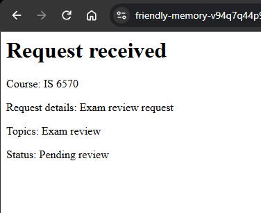

# Lab 4 Notes

## Part 1: Run the application
**What happens after submitting the form:**
After submiting the form a page is displayed stating that the request was recived and it displays the course, request details, topics, and status of the request.

**Screenshot:**
 

## Part 2: Trace the templates
1. **What content does header.php provide to every page?** 
   It provides the opening HTML structure, including the `<!DOCTYPE html>` declaration, the `<head>` section with metadata, the page title, and the linked stylesheet.
2. **What content does nav.php provide?** 
   It provides the main navigation menu/links so users can move between the different sections of the Peer Tutoring Hub application.
3. **What content does footer.php provide?** 
   It provides the closing HTML tags (like `</body>` and `</html>`), and shared footer text.
4. **Why is require_once appropriate for these files?** 
   It ensures that structural files like the header and footer are only included one time per page load. If `require_once` fails to find the file, it halts the script entirely, which is safer than rendering a broken page.
5. **Where is the shared CSS file linked?** 
   The `css/styles.css` file is linked inside `includes/header.php`.

## Part 3: Observe the form controls
1. **reason:** 
   This is a textarea feild where the user types what they need tutoring for. PHP receives it as a single string.
2. **topics[]:** 
   The square brackets indicate this is an array of checkboxes. PHP receives it as an indexed array of strings containing all selected topics.
3. **preferredtime:** 
   This is a time dropdown for selecting the appointment time the user can select from Morning, Afternoon, and Evening. PHP receives it as a single string.
4. **preferreddate:** 
   This is a date input for the appointment day. PHP receives it as a single string (usually formatted as YYYY-MM-DD).
5. **form name:** 
   This is a hidden input containing the name of the form in this instance but can be used to hold things like user identifier. PHP receives it as a single string.

## Part 4: Test validation behavior
| Test | Values Entered | Accepted/Rejected | Message Displayed | Business Rule Checked |
| :--- | :--- | :--- | :--- | :--- |
| **Valid request** | Topics: Exam review Course: IS 6570 Preferred time: Morning Preferred date: 11/11/2026 Reason: Exam review request | Accepted | Request received Course: IS 6570 Request details: Exam review request Topics: Exam review Status: Pending review | Validates that all required fields are present, at least one topic is selected, and the date is not in the past. |
| **Missing/invalid value** | Topics: \<no selection made\> Course: IS 6570 Preferred time: Morning Preferred date: 11/11/2026 Reason: Exam review request | Rejected | Request could not be submitted Select at least one valid topic. | Validates that required fields cannot be empty or null. |
| **Past date** | Topics: Exam review Course: IS 6570 Preferred time: Morning Preferred date: 07/04/1776 Reason: Exam review request  | Rejected | Request could not be submitted Preferred date cannot be in the past. | Validates that the `preferreddate` is greater than or equal to the current date. |

## Part 5: Review testing and CRUD pages
1. **Result shown for validation-tests.php:** 

   Valid time: PASS
   Missing time: PASS
   Altered value: PASS
   Multiple valid topics: PASS
   Missing topics: PASS
   Altered topic: PASS
   Minimum length: PASS
   Maximum length: PASS
   Too short: PASS
   Too long: PASS

2. **CRUD Action Mapping:**
   * **Create:** `request-form.php`
   * **Read one request:** `request-details.php`
   * **Read all requests:** `requests.php`
   * **Update:** `edit-request.php`
   * **Delete:** `delete-request.php`

3. **What query parameter appears in the request details URL?** 
   It uses the entrys associated request ID parameter `?request_id=` followed by the unique ID number of the request.
4. **Why is a GET query parameter appropriate for viewing one request?** 
   Viewing a record is a "Read" action that doesn't modify data on the server. Using a GET parameter also allows the URL to be bookmarked, refreshed, or shared.
5. **Why should an actual update or delete later use POST rather than GET?** 
   Update and delete are modifying actions that alter server data state. POST ensures the action requires an intentional form submission.