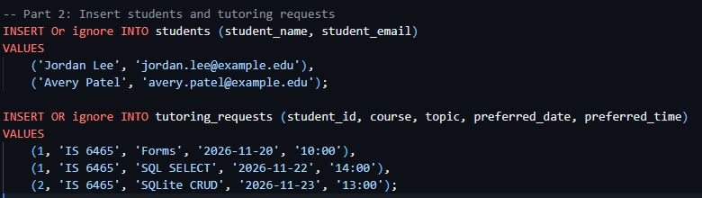
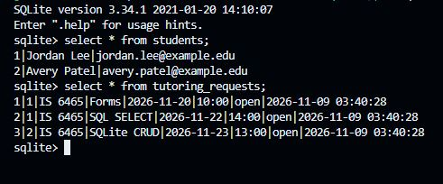
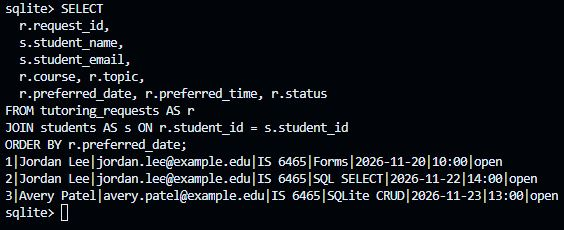
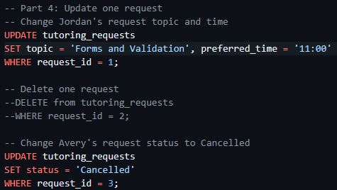
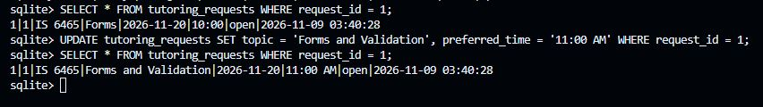
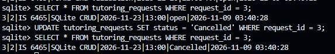
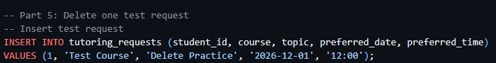
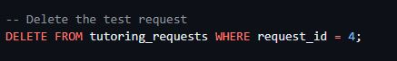
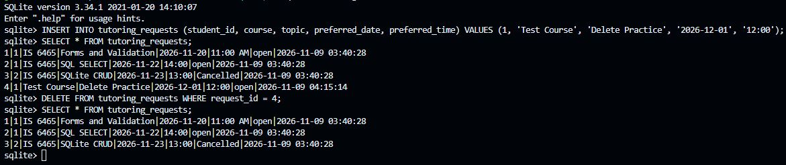

# Lab 5 Notes

## Part 1: Create the database tables
**1. Screenshot or pasted output showing table names and schema:**

**2. Which column is the primary key in each table?**
* In the `students` table, it is `student_id`.
* In the `tutoring_requests` table, it is `request_id`.

**3. Which column is the foreign key, and what relationship does it represent?**
The `student_id` column in the `tutoring_requests` table is the foreign key. It represents a one-to-many relationship, linking a specific tutoring request back to the unique student who created it. 

**4. Why is student email marked UNIQUE?**
It prevents duplicate accounts from being created. This ensures that every email address in the database belongs to one and only one student row, maintaining data integrity.

## Part 2: Insert students and tutoring requests
**1. INSERT statements used:**

**2. Screenshot or pasted SELECT output that shows the rows in both tables:**

**3. Explanation of why Jordan has one student row but two request rows:**
Because the database uses a relational model with a foreign key, Jordan only needs one entry in the `students` table. Every time Jordan submits a new request, a new row is added to the `tutoring_requests` table that references Jordan's single `student_id`, preventing redundant duplication of name and email data.

## Part 3: Read the stored data
**1. JOIN query and output:**

**2. What does the JOIN condition connect?**
The JOIN condition (`ON tr.student_id = s.student_id`) connects the foreign key in the `tutoring_requests` table to the primary key in the `students` table, combining the related data into a single result set.

**3. What is the difference between the purpose of JOIN and WHERE?**
A `JOIN` is used to combine columns from two or more related tables based on a shared relationship, whereas `WHERE` is used to filter the rows returned based on specific conditions.

**4. Why should the application retrieve one request by request_id instead of by topic alone?**
The `request_id` is a primary key, meaning it is guaranteed to be unique for every single row. If the application filtered by `topic` alone, it might accidentally retrieve multiple different requests from different students if they happened to ask for help on the same subject.

## Part 4: Update one request
**1. The two UPDATE statements used:**

**2. Before-and-after screenshot or pasted SELECT output for the revised request:**

**3. Screenshot or pasted query result showing Avery's Cancelled status:**

**4. Why is a specific WHERE clause essential in an UPDATE statement?**
Without a `WHERE` clause specifying exactly which row to change (like `request_id = 1`), the `UPDATE` statement would apply the change to every single row in the entire table. 

**5. Why does the Peer Tutoring Hub use a Cancelled status instead of immediately deleting a real request?**
Using a "Cancelled" status (often called a soft delete) preserves historical data and audit trails. It allows administrators to keep records of how many requests were made versus completed, while keeping the data safe from accidental permanent deletion.

## Part 5: Delete one test request
**1. INSERT statement for the test request:**

**2. DELETE statement used:**

**3. Screenshot or pasted output that verifies the test record was removed:**

**4. Why is a WHERE clause essential in a DELETE statement?**
Just like with `UPDATE`, if a `DELETE` statement does not include a `WHERE` clause to isolate a specific row, it will wipe out all records in the table. 

## Part 6: Reflect on the CRUD workflow
| CRUD action | SQL statement used in this lab | Peer Tutoring Hub example |
| :--- | :--- | :--- |
| **Create** | `INSERT INTO` | Submitting a new tutoring request form. |
| **Read** | `SELECT` | Viewing a list of all open requests or viewing one request's details. |
| **Update** | `UPDATE` | Changing the scheduled time or cancelling a request. |
| **Delete** | `DELETE FROM` | Permanently removing a cancelled or unwanted request. |

**1. How does the database preserve the connection between a student and that student's requests?**
It preserves the connection using a Foreign Key constraint. The `student_id` in the `tutoring_requests` table explicitly references the primary key `student_id` in the `students` table.

**2. Which database constraint prevents two student rows from using the same email address?**
The `UNIQUE` constraint on the `student_email` column prevents duplicate email entries in email colume in the table.

**3. What could happen if an UPDATE or DELETE statement did not include a WHERE clause?**
The database would apply the action globally, either overwriting every record with the same data (for an UPDATE) or permanently erasing all data in the table (for a DELETE).

**4. When the application later receives values from an HTML form, why should PHP send those values as parameters instead of placing them directly into SQL text?**
Placing form values directly into SQL text exposes the application to SQL Injection attacks, where malicious users could execute destructive commands on the database. Using prepared statements with parameters ensures the data is treated strictly as safe values, not executable code.