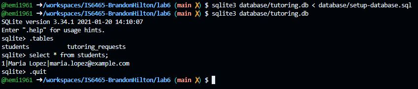
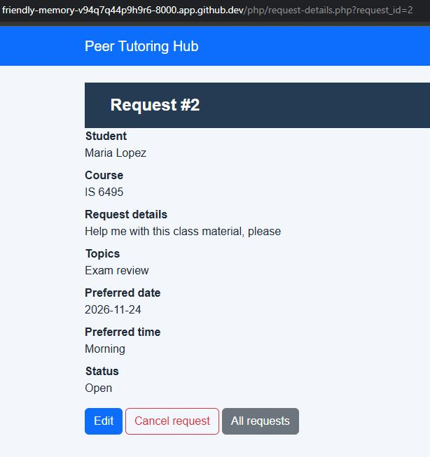

# Lab 6: PHP, PDO, and SQLite Integration Notes

**GitHub Codespaces Link:** [Insert your GitHub Codespaces link here]

---

## Part 1: Set Up the Database

**Command used to set up the database:**
```bash
sqlite3 database/tutoring.db < database/setup-database.sql
```

**Confirmation:**



---

## Part 2: Run the Application

**1. URL opened in the browser:**

https://friendly-memory-v94q7q44p9h9r6-8000.app.github.dev/php/request-form.php

**2. Request Confirmation:**

Once filled out with valid data the confirmation page loaded displaying the inputted request.

**3. Screenshot of the request detail page:**



---

## Part 3: Test the Application Workflows

| Test | What I Did | Expected Result | Actual Result | Pass or Fail |
| :--- | :--- | :--- | :--- | :--- |
| Submit a valid request | Submitted a request from the request form | A new tutoring request is created with status Open. | When a valid request is submitted the requests detail page is displayed | Pass |
| View all requests | Navigate to requests page | The new request appears in the request list. | A list of all requests are displayed | Pass |
| Filter requests | On the requests page set the filter to cancelled | Filtering by course or status shows matching requests. | Only canceled requests were displayed | Pass |
| Edit an Open request | clicking the edit button on a request details page  | The revised values are displayed. | Once the inputted changes were submitted the updated request details page was displayed | Pass |
| Cancel an Open request | On the requests details page click cancel and confirm | The request status changes to Cancelled. | redirected to update requests detailed page with request reflecting cancelation | Pass|
| Try to edit or cancel a cancelled request | navigate to the requests details page | The application does not allow the change. | The edit and cancel buttons are not present so you are not able to update or cancel the request | Pass |

---

## Part 4: Trace the Request Submission Workflow

**1. Which file displays the tutoring request form?**
php/request-form.php

**2. Which file receives the submitted form data?**
php/process-request.php

**3. Which file opens the PDO connection to SQLite?**
config/db.php

**4. Which file coordinates validation and the database transaction?**
services/requestService.php

**5. Which files contain the SQL statements?**
requestsPDO.php
studentPDO.php

**6. Which table stores student information?**
students

**7. Which table stores tutoring requests?**
tutoring_requests

**8. How does a tutoring request connect to the student who submitted it?**
Through a foreign key relationship; the tutoring_requests table contains a student_id column that references the primary key student_id in the students table.

**Explanation of SQL in Repository Files:**
Placing SQL statements in repository files enforces the separation of concerns, keeping database logic entirely separate from presentation and validation logic. This makes the application significantly easier to maintain and test, because if the database schema changes, a developer only needs to update the repository rather than hunting down SQL queries scattered across various web pages. It also improves security by centralizing database interactions where parameterized PDO queries can be strictly enforced.

---

## Part 5: Run the Integration Tests

**Integration Test Output:**
```text
There are 3 failures after reviewing the written tests. The tests assume there is no seeded data in the database, so since the database is not empty at generation, this results in unexpected values for the tests.
PASS UC01 create and Open
PASS Lab 4 checkbox values preserved
FAIL Duplicate email reuses student
FAIL UC02 course and status filter
PASS Invalid reason rejected
FAIL Invalid submission writes nothing
PASS Edit Open request
PASS Updated reason persisted
PASS Cancel Open request
PASS Cancelled row retained
PASS Second cancellation rejected
PASS Unrelated request unchanged
PASS FK enforced
PASS UC02 empty filter result
FAILURES: 3
```

---

## Part 6: Use the AI Skills Pack Process

### Application Builder

**My Prompt:**
Explain how a tutoring request moves from php/request-form.php through PHP, PDO, and SQLite in this project. Identify the responsibility of each file.

**AI Response:**
> When a user submits the form on php/request-form.php, the HTTP POST request sends the data to php/process-request.php, which acts as the controller. This file passes the raw data to services/requestService.php, where business logic and data validation occur. Once validated, the service calls repositories/studentPDO.php and repositories/requestPDO.php. These repository files use a shared PDO connection object to safely execute parameterized SQL INSERT statements, ultimately writing the new records into the students and tutoring_requests tables in the SQLite database.

**Evaluation:**
The statement that requestService.php handles validation is accurate. I verified this by opening requestService.php and looking for the validation logic blocks and reviewed the codes behavior.

### Traceability Auditor

**My Prompt:**
Trace the requirement "a student can submit a tutoring request" through the PHP files, service, repositories, SQLite tables, and integration tests in this project.

**AI Response:**
> Here is the traceability mapping for the requirement "a student can submit a tutoring request" across the application's architecture:

>Application Page: The workflow starts at php/request-form.php, displaying the HTML form. Upon submission, the form action sends the POST request to php/process-request.php, which acts as the controller.

>Service or Validation: The controller forwards the data to services/requestService.php. This service validates the input (e.g., checking for empty fields or invalid dates) and manages the workflow.

>Repository or SQL: Once validated, the service calls repositories/studentPDO.php (to insert or retrieve the student) and repositories/requestPDO.php (to insert the tutoring request using parameterized SQL queries).

>Database Table: The data is successfully inserted into the students table (storing name and email) and the tutoring_requests table (storing course, topic, date, time, and status) within the SQLite database.

>Test Evidence: This full flow is verified by tests/integration-tests.php, which programmatically submits a valid request and checks that the new record is successfully saved in the database without throwing validation errors.

**Traceability Table:**

| Requirement | Application Page | Service or Validation | Repository or SQL | Database Table | Test Evidence |
| :--- | :--- | :--- | :--- | :--- | :--- |
| Student submits a tutoring request | php/request-form.php & php/process-request.php | services/requestService.php | repositories/studentPDO.php & repositories/requestPDO.php | students & tutoring_requests | PASS UC01 create and Open |

### Test Harness Generator

**My Prompt:**
Suggest one useful test case for the Peer Tutoring Hub application. The test must relate to request creation, filtering, editing, cancellation, validation, or database integrity.

**AI Response:**
> Test Case: Invalid Date Submission Validation (Past Date). Attempt to submit a tutoring request where the preferred_date is in the past (e.g., yesterday's date).

**Evaluation:**
1. **Is it already covered by tests/integration-tests.php?** No, this is not currently covered. Looking at tests/integration-tests.php, the only validation failure being tested right now is a reason that is too short ($bad['reason']='short'). There is no negative test for invalid past dates.
2. **How to test manually or add to integration test file:** 
Manually: Open the browser form (php/request-form.php), use browser developer tools to bypass the HTML5 minimum date restriction if necessary, and submit a past date to ensure the server rejects it.
Integration Test: Add a new block in tests/integration-tests.php where $badDate = $sample; $badDate['preferreddate'] = '2020-01-01';. Then wrap submitRequest($pdo, $badDate); in a try/catch block and use the check() function to assert that an InvalidArgumentException is thrown.

3. **Is the AI generated test appropriate for this application?** Yes, this is appropriate. Scheduling applications must strictly be validated to be at future times to preserve integrity on the server side so students cannot accidentally (or maliciously) book tutors for days that have already occurred.

### Skills Pack Reflection

**Reflection:**
The AI tool provided a high-level map of the application's architecture, which made it much easier to understand how data flows from the frontend to the backend database. However, developers must always verify AI-generated outputs against the actual code because AI models can confidently hallucinate file names, assume standard design patterns that a specific project might not actually use, or suggest tests for features that haven't been built yet. Verifying ensures that the documentation and tests align with the actual source code reality.

---

## Part 7: Inspect the Database

**Explanation of the SQL JOIN:**
The JOIN clause in this query combines rows from two separate tables—tutoring_requests (aliased as r) and students (aliased as s). By stating ON r.student_id = s.student_id, it tells SQLite to match the foreign key in the requests table to the primary key in the students table. This allows the query to return a single, unified result set that shows the details of the tutoring request alongside the human-readable name and email of the specific student who submitted it, rather than just returning a numerical ID the user does not understand.