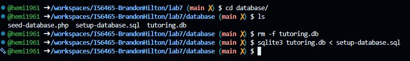
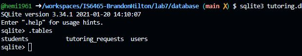
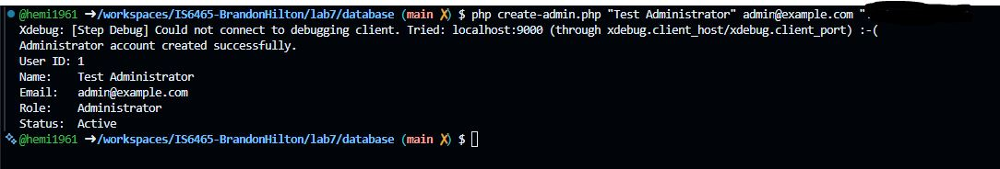

# Lab 7 Notes: Authentication and Authorization for the Peer Tutoring Hub

## Part 1: Generate the Lab 7 Application

### 1. AI Prompt Used

> Generate code for all user management use cases UM-01 through UM-10 in the User Management Design Document.
>
> Use the Application Builder, Test Harness Generator, and Traceability Auditor documents as implementation guidance. Follow the authentication, authorization, session management, password hashing, CSRF protection, and role based access practices in the Authentication Reading Handout.
>
> Use lab6.zip as the existing Peer Tutoring Hub application to extend. Preserve the Lab 6 three tier architecture and update the application as needed to support user registration, login, logout, profile management, administrator access, and protected tutoring request workflows.
>
> Return a complete Lab 7 application package with all updated and new files.

### 2. Uploaded Source Files

1. `Peer_Tutoring_Hub_User_Management_With_Diagrams.docx` (Peer Tutoring Hub User Management Design Document)
2. `application-builder.txt` (AI Skills Pack: Application Builder)
3. `test-harness-generator.txt` (AI Skills Pack: Test Harness Generator)
4. `traceability-auditor.txt` (AI Skills Pack: Traceability Auditor)
5. `IS6465_Authentication_Reading_Handout_v1.2_[16Nov2026].pdf` (Authentication Reading Handout)
6. `lab6.zip` (Existing Lab 6 Peer Tutoring Hub application)

### 3. How Lab 7 Extends the Lab 6 Application

Lab 7 preserves the Lab 6 three-tier architecture (`php/` for presentation, `services/` for validation and business workflows, and `repositories/` + `config/` + `database/` for SQLite data access) as well as the Lab 4 tutoring request form controls and JSON topic storage. It extends Lab 6 by:

- **Database layer:** Adding the `users` table (`user_id`, `full_name`, `email`, `password_hash`, `role`, `status`, `created_at`) and linking `students.user_id` as a `UNIQUE` foreign key referencing `users(user_id)`.
- **Security & shared helpers:** Adding `includes/auth.php` for secure session cookie parameters, `session_regenerate_id(true)`, 20-minute inactivity timeout, fresh database user/status reload via `requireLogin()`, role checks via `requireRole()`, and CSRF token creation/verification via `csrfToken()` and `verifyCsrfToken()`.
- **User management (UM-01 through UM-10):** Adding `repositories/userPDO.php`, `services/userService.php`, and user/admin pages (`php/register.php`, `php/login.php`, `php/logout.php`, `php/profile.php`, `php/edit-profile.php`, `php/change-password.php`, `php/admin-users.php`, `php/admin-user-detail.php`, `php/admin-user-role.php`, `php/admin-user-status.php`, and `php/admin-user-delete.php`).
- **Protected tutoring workflows:** Updating the existing tutoring request pages, `services/requestService.php`, and `repositories/requestPDO.php` so all request pages require authentication, enforce Student/Administrator role rules (denying Tutors in Lab 7), require CSRF tokens on state-changing POST actions, and enforce SQL-level record ownership (`WHERE s.user_id = ?`) for students.

### 4. Example of Generated Code Verified Against the Design Document or Reading Handout

- **Verified File:** `includes/auth.php` (`requireLogin()`, `loginUserSession()`, `verifyCsrfToken()`) and `services/userService.php` (`registerUser()`, `authenticateUser()`)
- **Verification Findings:**
  - Verified against the **Authentication Reading Handout (Sections 4, 6–10, 17):** `startSecureSession()` configures `httponly`, `samesite = 'Lax'`, and HTTPS-aware `secure` cookie parameters before `session_start()`. `registerUser()` hashes passwords with `password_hash($password, PASSWORD_DEFAULT)`, `authenticateUser()` checks `status === 'Active'` and `password_verify()`, `loginUserSession()` calls `session_regenerate_id(true)`, and `requireLogin()` enforces a 1200-second (20-minute) timeout while reloading the user from SQLite on every protected request.
  - Verified against the **User Management Design Document (UM-01):** `validateRegistrationRole()` restricts public registration to `Student` or `Tutor` only, blocking public `Administrator` creation.

---

## Part 2: Set Up the Database

> **Note on the generated `lab7` package:** In the generated package, `database/setup-database.sql` already contains the full three-table schema (`users`, `students` with `user_id`, and `tutoring_requests`), and `database/seed-database.php` creates/seeds `tutoring.db`.

### 1. Database Setup Commands Run

```bash
cd lab7/database
sqlite3 tutoring.db < setup-database.sql
```



### 2. Table Verification Confirmation

After running the database setup commands, I opened the `tutoring.db` database file with `sqlite3` and verified that all three required tables (`students`, `tutoring_requests`, and `users`) were created by running `.tables`.

### 3. SQLite `.tables` Output or Screenshot



---

## Part 3: Create an Administrator Account

### 1. Command Structure Used (Password Redacted)

```bash
php create-admin.php "Test Administrator" admin@example.com "<REDACTED_PASSWORD>"
```



### 2. Confirmation Statement

After the command was run, the message `Administrator account created successfully.` was displayed to the console along with the created account details (User ID, Name, Email, Role, and Status).

### 3. Test Administrator Email Address

- **Email:** `admin@example.com`

### 4. Assigned Role

- **Role:** `Administrator`

---

## Part 4: Run the Application

### 1. Browser URL Opened

- **Command used:** `php -S 0.0.0.0:8000`
- **Browser URL:** `https://friendly-memory-v94q7q44p9h9r6-8000.app.github.dev/php/login.php`

### 2. Confirmation Statement

The application opened successfully in GitHub Codespaces; starting the PHP server and opening port 8000 routed cleanly from `index.php` to the login page.

### 3. Behavior When Accessing Without Being Logged In

When accessing the application root (`/`) without an active session, `index.php` redirects to `php/login.php`. Attempting to open any protected page directly (such as `php/profile.php`, `php/requests.php`, `php/request-form.php`, or `php/admin-users.php`) triggers `requireLogin($pdo)` in `includes/auth.php`, which detects that `$_SESSION['user_id']` is empty and redirects the browser to `php/login.php`.

---

## Part 5: Test the Student Workflow

### Student Workflow Test Results

| Test | What I Did | Expected Result | Actual Result | Pass or Fail |
|---|---|---|---|---|
| Register student account | Opened Create Account, entered test name, test email, password/confirmation, selected Student, and submitted | Student account is created | Confirmation banner displayed that the Active student account was created | Pass |
| Log in as student | Entered registered student email and password on `login.php` and submitted | Student can access protected student pages | Redirected to `profile.php` showing student profile details and student navigation links | Pass |
| View or update profile | Viewed My Profile, clicked Edit Profile, updated name/email, and saved | Profile information is displayed or saved | Updated profile details saved and displayed on `profile.php` | Pass |
| Create tutoring request | Opened Request a Session, selected course, date, topics, time, reason, and submitted | A new request is created with status Open | Redirected to `request-details.php` showing the newly created request with status `Open` | Pass |
| Edit Open request | Opened request details, clicked Edit, updated reason/course, and saved | Updated request information is displayed | Revised request details persisted and displayed on `request-details.php` | Pass |
| View my requests | Clicked My Requests in the navigation bar | Student sees the student's own requests | Request list displayed only the logged-in student's tutoring requests | Pass |
| Log out | Clicked Log Out button in navigation bar | Session ends and login page appears | Session cleared and redirected to `login.php?logged_out=1` | Pass |

### Student Workflow Screenshots


---

## Part 6: Test the Administrator Workflow

### Manual Verification Summary

I was able to log in to the administrator account and view information beyond a single student's records, including administrator-restricted user management (`php/admin-users.php`) and all student tutoring requests across the system (`php/requests.php`).

### Authentication & Authorization Questions

1. **What is authentication in this application?**
   Authentication is the process of verifying who a user is before granting an application identity. In Lab 7, `php/login.php` and `authenticateUser()` in `services/userService.php` look up the submitted email in the `users` table, verify that the account status is `Active`, compare the submitted password against the stored `password_hash` with `password_verify()`, and then establish a trusted server-side PHP session via `loginUserSession()`.

2. **What is authorization in this application?**
   Authorization occurs after authentication and determines what the signed-in user is permitted to view or modify based on their role, record ownership, and record status. In Lab 7, `requireRole()` in `includes/auth.php` checks the user's authoritative role reloaded from SQLite, service functions enforce business rules (such as preventing public admin registration or profile role tampering), and `repositories/requestPDO.php` enforces record ownership directly in SQL (`WHERE s.user_id = ?`).

3. **How is student access different from administrator access?**
   - **Students** can view/edit their own profile, change their own password, submit new tutoring requests (bound to their authenticated account), and view, edit, or cancel **only their own** `Open` tutoring requests. Students cannot access user management pages or view/modify other students' requests.
   - **Administrators** can manage their own profile/password, search and inspect **all** user accounts, update user roles, activate/deactivate accounts, delete eligible accounts under retention rules, and view, edit, or cancel **any** student's `Open` tutoring requests across the system. Administrators cannot submit student tutoring requests via `request-form.php`.

4. **Which functions or pages should be limited to administrators?**
   - **Pages:** `php/admin-users.php`, `php/admin-user-detail.php`, `php/admin-user-role.php`, `php/admin-user-status.php`, and `php/admin-user-delete.php` (all guarded by `requireRole($currentUser, array('Administrator'))`), as well as system-wide visibility/management of all students' requests on `php/requests.php`, `php/request-details.php`, `php/edit-request.php`, `php/update-request.php`, and `php/delete-request.php`.
   - **Service functions (`services/userService.php`):** `listUsersForAdmin()`, `getUserDetailsForAdmin()`, `updateUserRoleForAdmin()`, `updateUserStatusForAdmin()`, and `deleteUserAccountForAdmin()` (each calling `assertAdministratorActor()`).

5. **What happens after logout if a user tries to visit a protected page directly?**
   Submitting the logout form sends a CSRF-protected `POST` request to `php/logout.php`, which calls `logoutSession()` to clear `$_SESSION`, expire the session cookie in the browser, and destroy the server-side session file. If the user then enters a protected URL directly (such as `php/profile.php`, `php/requests.php`, or `php/admin-users.php`), `requireLogin($pdo)` finds no authenticated `$_SESSION['user_id']` and immediately redirects the browser to `php/login.php` before outputting any protected content.

### Administrator Screenshot


---

## Part 7: Trace Registration and Login

### Student Registration Workflow

1. **Which file displays the Create Account form?**
   `php/register.php` (when accessed with HTTP `GET`).
2. **Which file receives the submitted registration form?**
   `php/register.php` (handles the HTTP `POST` submission directly and delegates to `registerUser($pdo, $_POST)`).
3. **Which file or function creates and verifies the CSRF token?**
   `includes/auth.php`: `csrfToken()` generates and stores a 256-bit random token in `$_SESSION['csrf_token']` for the hidden form input, and `verifyCsrfToken($_POST)` validates the submitted token using `isValidCsrfToken()` and `hash_equals()`.
4. **Which service validates the registration information?**
   `services/userService.php`, inside the function `registerUser($pdo, $input)` (which invokes helper validators in `includes/validation.php`: `validateFullName()`, `validateEmailAddress()`, `validatePasswordStrength()`, and `validateRegistrationRole()`, and checks for duplicate emails via `findUserByEmail()`).
5. **Where is the password hashed?**
   In `services/userService.php` inside `registerUser()`, using PHP's `password_hash($password, PASSWORD_DEFAULT)`.
6. **Which repository files insert user and student data?**
   - `repositories/userPDO.php` (`insertUser()`) inserts the new user account into the `users` table during registration.
   - `repositories/studentPDO.php` (`insertStudentIfAbsent()` / `linkStudentToUser()`) creates or links the corresponding `students` record inside a transaction in `services/requestService.php` (`submitRequest()`) when the student submits their first tutoring request.
7. **Which database tables receive records when a student registers?**
   The `users` table receives the new `Active` account record immediately upon registration. The `students` table receives a linked student record (with `students.user_id` referencing `users.user_id`) when the student submits a tutoring request.

### User Login Workflow

1. **Which file displays the login form?**
   `php/login.php` (when accessed with HTTP `GET`).
2. **Which file receives the submitted login credentials?**
   `php/login.php` (handles the HTTP `POST` submission, calls `verifyCsrfToken($_POST)`, and passes credentials to `authenticateUser()`).
3. **Which repository retrieves a user by email address?**
   `repositories/userPDO.php`, via `findUserByEmail($pdo, $email)` using a prepared statement.
4. **Where is the submitted password verified?**
   In `services/userService.php` inside `authenticateUser($pdo, $email, $password)`, which checks that the user exists, has `status === 'Active'`, and matches the stored hash via `password_verify($rawPassword, $user['password_hash'])` (and upgrades outdated hashes with `password_needs_rehash()`).
5. **What session actions occur after successful login?**
   `loginUserSession($authenticated)` in `includes/auth.php` starts the secure session, calls `session_regenerate_id(true)`, stores minimal trusted session values (`user_id`, `display_name`, `role`, `last_activity`), rotates `$_SESSION['csrf_token']`, and `php/login.php` sends a `303` redirect to `profile.php`.
6. **Why should the application regenerate the session ID after login?**
   Regenerating the session ID at the authentication boundary prevents **session fixation** attacks, where an attacker plants or observes a pre-login session ID and attempts to reuse it after the victim authenticates. Issuing a brand-new server session ID invalidates any previously known identifier.
7. **How does the application determine whether the logged-in user is a student or administrator?**
   On every protected request, `requireLogin($pdo)` in `includes/auth.php` reloads the current user record from SQLite via `findUserById($pdo, (int)$_SESSION['user_id'])` and refreshes `$_SESSION['role']` from that authoritative database row (never trusting browser-supplied roles). Each protected page then calls `requireRole($currentUser, $allowedRoles)` and services enforce role and SQL ownership checks (`s.user_id = ?`).

### Why Password Hashing and Verification Belong in the Application Layer

Password hashing and verification belong in the application (service) layer because credential protection is a core security and business rule that must be enforced consistently for every entry point, including registration, login, and password changes. Placing password logic in presentation pages risks duplicating or omitting security checks across forms and mixes HTML rendering with sensitive authentication logic. Placing it in database setup scripts only handles initial static seed data and cannot validate dynamic runtime submissions or safely compare plaintext passwords with `password_verify()` without exposing credentials to SQL queries.

---

## Part 8: Run the Automated Tests

### 1. Validation Tests (`php tests/validation-tests.php`)

- **Overall Result:** Passed (`19 passed, 0 failed`)

```text
PASS: PreferredTime: Valid time
PASS: PreferredTime: Missing time
PASS: PreferredTime: Altered value
PASS: Topics: Multiple valid topics
PASS: Topics: Missing topics
PASS: Topics: Altered topic
PASS: Reason: Minimum length
PASS: Reason: Maximum length
PASS: Reason: Too short
PASS: Reason: Too long
PASS: FullName: Valid
PASS: FullName: Too short
PASS: Email: Valid
PASS: Email: Invalid
PASS: Password: Valid 8+ chars
PASS: Password: Too short
PASS: PublicRole: Student allowed
PASS: PublicRole: Tutor allowed
PASS: PublicRole: Administrator blocked
Results: 19 passed, 0 failed
```

### 2. User Management Tests (`php tests/user-management-tests.php`)

- **Overall Result:** Passed (`46 passed, 0 failed`)

```text
PASS: UM-01: Valid Student registration creates Active user with normalized email
PASS: UM-01: Password stored as one-way password_hash, not plaintext
PASS: UM-01: Valid Tutor registration creates Active user
PASS: UM-01: Duplicate email registration rejected
PASS: UM-01: Public registration attempting Administrator role is denied with no DB write
PASS: UM-01: Registration with mismatched passwords rejected
PASS: UM-01: Registration with password under 8 characters rejected
PASS: UM-02: View own profile returns permitted fields and omits password_hash
PASS: UM-03: Admin lists all 4 accounts without filters
PASS: UM-03: Admin search by name returns matching account
PASS: UM-03: Admin combined role and status filter returns matching account
PASS: UM-03: Admin search with no matches returns empty list
PASS: UM-03: Non-administrator denied from viewing/searching user accounts
PASS: Ownership: Student 1 sees only own tutoring request in list
PASS: Ownership: Student 1 cannot view Student 2 tutoring request
PASS: Ownership: Student 1 cannot edit Student 2 tutoring request
PASS: Ownership: Student 1 cannot cancel Student 2 tutoring request
PASS: Authorization: Tutor denied from submitting tutoring requests
PASS: Authorization: Tutor denied from viewing tutoring requests
PASS: Authorization: Administrator denied from submitting student tutoring requests
PASS: Authorization: Administrator views all tutoring requests across students
PASS: UM-04: Profile update saves name/email and synchronizes linked students record
PASS: UM-04: Role modification via profile edit is denied and role remains Student
PASS: UM-04: Profile update with another user email is rejected
PASS: UM-05: Password change rejected when current password is wrong
PASS: UM-05: New password succeeds on login and old password fails
PASS: UM-06: Unauthorized non-admin role update denied
PASS: UM-06: Demoting the last active Administrator is prevented
PASS: UM-06: Admin promotes Tutor to Administrator
PASS: UM-06: Admin changes role back to Tutor
PASS: UM-07: Deactivated user cannot log in
PASS: UM-07: Reactivated user can log in again
PASS: UM-07: Deactivating own/last active Administrator is prevented
PASS: UM-08: Unconfirmed deletion is rejected
PASS: UM-08: Deletion of account with related tutoring requests is blocked and records retained
PASS: UM-08: Confirmed deletion of account with 0 related tutoring requests succeeds
PASS: UM-09: Valid login authenticates case-insensitively and omits password_hash
PASS: UM-09: Invalid password fails authentication
PASS: UM-09: Unknown email fails authentication
PASS: Security: Valid CSRF token accepted
PASS: Security: Tampered CSRF token rejected
PASS: Security: Empty CSRF token rejected
PASS: Security: Session active at exactly 1200 seconds
PASS: Security: Session expires after 1200 seconds inactivity
PASS: UM-09: loginUserSession stores minimal trusted session state
PASS: UM-10: logoutSession clears session state cleanly
Results: 46 passed, 0 failed
```

### 3. Integration Tests (`php tests/integration-tests.php`)

- **Overall Result:** Passed (`18 passed, 0 failed`)

```text
PASS: UC01: Create request with default Open status and JOIN retrieval
PASS: UC01: Lab 4 checkbox topics preserved in JSON
PASS: UC01: Reason textarea with quotes preserved
PASS: UC01: Duplicate student email reuses existing student
PASS: UC02: No filters returns all saved requests
PASS: UC02: Combined course and status filter returns matches
PASS: UC01: Invalid reason rejected
PASS: UC01: Invalid submission writes nothing
PASS: UC01: Edit Open request succeeds
PASS: UC01: Updated reason persisted
PASS: UC01: Cancel Open request succeeds
PASS: UC01: Cancelled record retained with Cancelled status
PASS: UC01: Second cancellation rejected
PASS: UC01: Editing Cancelled request rejected
PASS: UC01: Unrelated request unchanged
PASS: Database: Foreign key constraint enforced
PASS: UC02: Empty filter result handled
PASS: UC02: Status-only filter returns cancelled record
Results: 18 passed, 0 failed
```

### 4. Failed Test Investigation (Complete Only If Any Test Failed)

All tests across all three suites passed with 0 failures.

---

## Part 9: Use the AI Skills Pack Process

### 1. Application Builder

**Prompt Used:**
> Explain how a student registration request moves from register.php through authentication checks, PHP services, repositories, PDO, and SQLite in the Peer Tutoring Hub application. Identify the responsibility of each file or layer.

**AI Response:**

A student registration request (`UM-01`) moves through the three-tier architecture as follows:

1. **Presentation & Request Controller (`php/register.php`, `includes/header.php`, `includes/nav.php`, `includes/footer.php`):**
   - On `GET`, `php/register.php` opens a database connection (`openDatabase()`), starts the session (`startSecureSession()`), and redirects already-authenticated users to `profile.php` (`HTTP 303`).
   - It displays the HTML5/Bootstrap registration form (`full_name`, `email`, `password`, `confirm_password`, and `role` radio buttons limited to `Student` or `Tutor`) along with a hidden `csrf_token` field generated by `csrfToken()`.
   - On `POST`, `php/register.php` acts as the controller: it rejects unsupported HTTP methods (`405`), calls `verifyCsrfToken($_POST)`, passes `$_POST` to `registerUser($pdo, $_POST)`, and handles outcomes by showing a confirmation message on success, returning `422` with validation errors on `InvalidArgumentException`, or logging errors and returning `500` on `Throwable`.

2. **Session & CSRF Security Layer (`includes/auth.php`):**
   - `startSecureSession()` configures cookie protections (`httponly`, `samesite=Lax`, HTTPS-aware `secure`, `session.use_only_cookies`, `session.use_strict_mode`) before calling `session_start()`.
   - `csrfToken()` generates a 32-byte random hex token (`bin2hex(random_bytes(32))`) stored in `$_SESSION['csrf_token']`.
   - `verifyCsrfToken($_POST)` validates the submitted token against the session token using timing-safe `hash_equals()` via `isValidCsrfToken()`, exiting with `HTTP 403` if missing or invalid.

3. **Business Logic & Validation Layer (`services/userService.php`, `includes/validation.php`):**
   - `registerUser($pdo, $input)` normalizes the email (`normalizeEmail()`) and enforces all `UM-01` validation rules via `includes/validation.php`: `validateFullName()` (2–120 characters), `validateEmailAddress()`, `validatePasswordStrength()` (8–72 characters), exact password confirmation match, and `validateRegistrationRole()` (allowing only `Student` or `Tutor` and blocking public `Administrator` registration).
   - It checks for existing accounts using `findUserByEmail($pdo, $email)`.
   - It hashes the password one-way using `password_hash($password, PASSWORD_DEFAULT)`—never storing plaintext passwords or confirmation fields—and creates the user with status `'Active'` via `insertUser()`.

4. **Data Access / Repository & PDO Layer (`config/db.php`, `repositories/userPDO.php`):**
   - `openDatabase()` in `config/db.php` creates the PDO SQLite connection to `database/tutoring.db`, enables `PDO::ATTR_ERRMODE => PDO::ERRMODE_EXCEPTION` and `PDO::ATTR_DEFAULT_FETCH_MODE => PDO::FETCH_ASSOC`, and executes `PRAGMA foreign_keys = ON`.
   - `findUserByEmail()` and `insertUser()` in `repositories/userPDO.php` isolate all SQL and execute parameterized prepared statements (`:full_name`, `:email`, `:password_hash`, `:role`, `:status`) to prevent SQL injection, returning the new `user_id` via `(int)$pdo->lastInsertId()`.

5. **Database Layer (`database/setup-database.sql`, `database/tutoring.db`):**
   - SQLite inserts the new row into the `users` table and enforces database-level integrity constraints: `email TEXT NOT NULL UNIQUE`, `CHECK (role IN ('Student', 'Tutor', 'Administrator'))`, and `CHECK (status IN ('Active', 'Inactive'))`.
   - Note: Registration writes only to `users`. The linked row in `students` (`students.user_id`) is created inside a transaction when the student submits their first tutoring request via `submitRequest()` in `services/requestService.php`.

**Verification Against Actual Code:**
- **Accurate statement verified:** *"Public registration blocks `Administrator` creation at the service/validation layer, checks for duplicate emails, hashes the password with `password_hash($password, PASSWORD_DEFAULT)`, and inserts an `Active` record into `users` using a parameterized prepared statement."*
- **Code check:**
  - Verified in `includes/validation.php`: `validateRegistrationRole($role)` sets `$allowedPublicRoles = array('Student', 'Tutor')` and rejects any other role (including `'Administrator'`).
  - Verified in `services/userService.php`: `registerUser()` calls `validateRegistrationRole($role)`, checks `findUserByEmail($pdo, $email) !== false`, computes `$passwordHash = password_hash($password, PASSWORD_DEFAULT);`, and calls `insertUser($pdo, $fullName, $email, $passwordHash, $role, 'Active')`.
  - Verified in `repositories/userPDO.php`: `insertUser()` prepares `INSERT INTO users (full_name, email, password_hash, role, status) VALUES (:full_name, :email, :password_hash, :role, :status)` and binds parameters in `$stmt->execute(...)`.
  - Verified in `php/register.php`: no SQL exists in the presentation page, and `verifyCsrfToken($_POST)` executes before `registerUser($pdo, $_POST)`.

---

### 2. Traceability Auditor

**Prompt Used:**
> Trace the requirement "a student can register, log in, create a tutoring request, and log out" through the presentation pages, authentication code, services, repositories, SQLite tables, and automated tests in this project.

**AI Response:**

#### End-to-End Requirements Traceability: Student Tutoring Workflow

**Traced Requirement:** *"A student can register, log in, create a tutoring request, and log out."*

**Covered Use Cases:**
- **UM-01:** Create User Account (Student/Tutor self-registration)
- **UM-09:** Log In
- **UC01 (Protected):** Request Tutoring (with Lab 7 RBAC, CSRF, and SQL ownership)
- **UM-10:** Log Out

**Architecture Flow:** `Browser → Presentation (php/) → Auth & Validation (includes/) → Service (services/) → Repository (repositories/) → SQLite (database/)`

| Workflow Step | Presentation Pages | Auth & Validation (`includes/`) | Service (`services/`) | Repository (`repositories/`) | SQLite Tables (`database/setup-database.sql`) | Automated Tests & Evidence Status |
|---|---|---|---|---|---|---|
| **1. Register (UM-01)** | `php/register.php` | `auth.php`: `startSecureSession()`, `csrfToken()`, `verifyCsrfToken()`<br>`validation.php`: `validateFullName()`, `normalizeEmail()`, `validateEmailAddress()`, `validatePasswordStrength()`, `validateRegistrationRole()` | `userService.php`: `registerUser()` | `userPDO.php`: `findUserByEmail()`, `insertUser()` | `users` (`email UNIQUE`, `role CHECK`, `status DEFAULT 'Active'`) | `tests/user-management-tests.php` (6 UM-01 checks) — **Verified at service/DB layer** (`PASS` in CLI run)<br>`tests/validation-tests.php` — **Implemented, unverified** (not yet executed) |
| **2. Log In (UM-09)** | `index.php`, `php/login.php`, `php/profile.php` | `auth.php`: `startSecureSession()`, `verifyCsrfToken()`, `loginUserSession()`, `requireLogin()` | `userService.php`: `authenticateUser()`, `getUserProfile()` | `userPDO.php`: `findUserByEmail()`, `updateUserPasswordHash()`, `findUserById()` | `users` (reads `password_hash`, `status`, `role`, `user_id`) | `tests/user-management-tests.php` — **Partial** (`authenticateUser` verified; `loginUserSession` emitted CLI `Headers already sent` warnings on `session_start`/`session_regenerate_id`) |
| **3. Create Tutoring Request (UC01 + RBAC)** | `php/request-form.php`, `php/process-request.php`, `php/request-details.php` | `auth.php`: `requireLogin()`, `requireRole(['Student'])`, `csrfToken()`, `verifyCsrfToken()`<br>`validation.php`: `validatePreferredTime()`, `validateTopics()`, `validateReason()` | `requestService.php`: `submitRequestForStudent()`, `submitRequest()`, `validateSubmission()`, `findRequestForActor()`, `decodeTopic()` | `userPDO.php`: `findUserById()`<br>`studentPDO.php`: `findStudentByUserId()`, `findStudentByEmail()`, `linkStudentToUser()`, `insertStudentIfAbsent()`<br>`requestPDO.php`: `insertTutoringRequest()`, `findRequestForUser()` | `users` ← `students` (`user_id UNIQUE FK`) ← `tutoring_requests` (`student_id FK`, `status DEFAULT 'Open'`, JSON `topic`) | `tests/user-management-tests.php` (Student submission, ownership, Tutor/Admin denial) — **Verified at service/DB layer**<br>`tests/integration-tests.php` — **Implemented, unverified** (not yet executed) |
| **4. Log Out (UM-10)** | `includes/nav.php`, `php/logout.php`, `php/login.php` | `auth.php`: `startSecureSession()`, `verifyCsrfToken()`, `logoutSession()` | None (session and cookie state only) | None | None | `tests/user-management-tests.php` — **Partial** (`$_SESSION` cleared, but CLI `session_start` warning prevented full `session_destroy()`/cookie expiry verification) |

##### Step-by-Step Vertical Trace

1. **Student Registers (`UM-01`):**
   - **Presentation (`lab7/php/register.php`):** Displays the registration form with `full_name`, `email`, `password`, `confirm_password`, `Student`/`Tutor` radio buttons for `role`, and a hidden `csrf_token` field generated by `csrfToken()`. Already-authenticated visitors are redirected to `profile.php`. On `POST`, it checks `verifyCsrfToken($_POST)`, calls `registerUser($pdo, $_POST)`, displays an Active-account confirmation linking to `login.php`, or returns HTTP `422` on validation failures.
   - **Authentication & Validation (`lab7/includes/auth.php`, `lab7/includes/validation.php`):** `verifyCsrfToken()` validates the token using `hash_equals()` and aborts with HTTP `403` on mismatch. Validation helpers enforce a 2–120 character name (`validateFullName()`), normalized RFC email (`normalizeEmail()`, `validateEmailAddress()`), 8–72 character password (`validatePasswordStrength()`), and public roles restricted strictly to `'Student'` or `'Tutor'` (`validateRegistrationRole()`).
   - **Service (`lab7/services/userService.php`):** `registerUser($pdo, $input)` runs all field validations, requires `$password === $confirmPassword`, checks for an existing account via `findUserByEmail($pdo, $email)`, hashes the password with `password_hash($password, PASSWORD_DEFAULT)`, and calls `insertUser(..., 'Active')`.
   - **Repository (`lab7/repositories/userPDO.php`):** `findUserByEmail()` runs a parameterized `SELECT` against `users WHERE email = :email`, and `insertUser()` runs a parameterized `INSERT INTO users (full_name, email, password_hash, role, status)` returning `lastInsertId()`.
   - **SQLite Table (`lab7/database/setup-database.sql`):** Writes one row to `users`, where SQLite independently enforces `email TEXT NOT NULL UNIQUE`, `role CHECK (role IN ('Student', 'Tutor', 'Administrator'))`, and `status DEFAULT 'Active' CHECK (status IN ('Active', 'Inactive'))`.
   - **Automated Tests:** `tests/user-management-tests.php` registers a Student (`Priya Patel`) with mixed-case email and verifies normalized email storage, `Active` status, non-plaintext `password_hash` verification, duplicate-email rejection, public `Administrator` role blocking with zero DB writes, password mismatch rejection, and short-password rejection. `tests/validation-tests.php` unit-tests the underlying validation functions directly.

2. **Student Logs In (`UM-09`):**
   - **Presentation (`lab7/index.php`, `lab7/php/login.php`, `lab7/php/profile.php`):** Unauthenticated requests to `index.php` redirect (`302`) to `php/login.php`. `login.php` renders `email`, `password`, and a hidden `csrf_token`. On `POST`, it calls `verifyCsrfToken($_POST)` and `authenticateUser($pdo, $formEmail, $password)`. Failed attempts return HTTP `401` with the generic message `'Invalid email or password.'` so account existence and status are not revealed; valid logins invoke `loginUserSession($authenticated)` and redirect (`303`) to `profile.php`. `profile.php` runs `requireLogin($pdo)`, loads `getUserProfile()`, and displays Student links to `request-form.php` and `requests.php`.
   - **Authentication (`lab7/includes/auth.php`):** `startSecureSession()` configures `session.use_only_cookies`, `session.use_strict_mode`, `httponly => true`, `samesite => 'Lax'`, and HTTPS-aware `secure` before calling `session_start()`. `loginUserSession($user)` calls `session_regenerate_id(true)` to prevent session fixation, stores minimal trusted values (`user_id`, `display_name`, `role`, `last_activity`) in `$_SESSION`, and rotates `csrf_token`.
   - **Service (`lab7/services/userService.php`):** `authenticateUser($pdo, $email, $password)` normalizes the email, retrieves the user via `findUserByEmail()`, checks `$user['status'] === 'Active'` and `password_verify()`, transparently upgrades hashes via `password_needs_rehash()` + `updateUserPasswordHash()`, and unsets `password_hash` before returning the user array.
   - **Repository (`lab7/repositories/userPDO.php`):** `findUserByEmail()` retrieves the candidate row (including `password_hash` and `status`), `updateUserPasswordHash()` persists rehashed credentials when needed, and `findUserById()` loads profile fields without `password_hash` for `profile.php`.
   - **SQLite Table (`lab7/database/setup-database.sql`):** Queries `users` by unique `email` during authentication and by `user_id` on subsequent protected requests.
   - **Automated Tests:** `tests/user-management-tests.php` verifies case-insensitive login omitting `password_hash`, failure on wrong password, failure on unknown email, failure on `Inactive` accounts, and `loginUserSession()` populating `$_SESSION['user_id']` and `$_SESSION['role']`.

3. **Student Creates a Tutoring Request (`UC01` + Lab 7 Protection):**
   - **Presentation (`lab7/php/request-form.php`, `lab7/php/process-request.php`, `lab7/php/request-details.php`):**
     - `request-form.php` enforces `requireLogin($pdo)` and `requireRole($currentUser, array('Student'))`, renders the Student's `full_name` and `email` as read-only inputs, preserves the Lab 4 controls (`course` dropdown, `preferreddate`, `reason` textarea, `topics[]` checkboxes, `preferredtime` radios), and embeds hidden `form_name="tutoring_request"` and `csrf_token`.
     - `process-request.php` requires `POST` (`405` otherwise), runs `requireLogin($pdo)`, `requireRole($currentUser, array('Student'))`, and `verifyCsrfToken($_POST)`, validates `form_name`, calls `submitRequestForStudent($pdo, $currentUser, $_POST)`, and redirects (`303`) to `request-details.php?request_id=<id>` (or returns HTTP `422` on invalid input).
     - `request-details.php` enforces `requireLogin($pdo)` and `requireRole($currentUser, array('Student', 'Administrator'))`, loads the record via `findRequestForActor($pdo, $currentUser, $id)` (returning HTTP `404` if missing or owned by another student), decodes JSON topics via `decodeTopic()`, and displays the saved request.
   - **Authentication & Validation (`lab7/includes/auth.php`, `lab7/includes/validation.php`):** On every request, `requireLogin($pdo)` verifies `$_SESSION['user_id']`, checks the 20-minute (`1200`-second) inactivity timeout via `isSessionExpired()`, reloads the account from SQLite via `findUserById()` to confirm `status === 'Active'`, and refreshes `last_activity`, `display_name`, and `role`. `requireRole()` returns HTTP `403` to Tutors or Administrators attempting to access the submission workflow. `validatePreferredTime()`, `validateTopics()`, and `validateReason()` enforce Lab 4 rules.
   - **Service (`lab7/services/requestService.php`):** `submitRequestForStudent()` verifies `hasAllowedRole($actor, array('Student'))`, overwrites `student_name` and `student_email` with trusted values from `$actor` (preventing client tampering), and delegates to `submitRequest($pdo, $boundInput, (int)$actor['user_id'])`. `submitRequest()` validates fields via `validateSubmission()` (serializing `{reason, topics}` to JSON in `topic`) and wraps student lookup/creation/linking plus request insertion in a single PDO transaction (`beginTransaction()` / `commit()` / `rollBack()`). For confirmation display, `findRequestForActor()` routes Students to `findRequestForUser()`.
   - **Repositories (`lab7/repositories/studentPDO.php`, `lab7/repositories/requestPDO.php`, `lab7/repositories/userPDO.php`):** `findUserById()` refreshes session identity; `findStudentByUserId()`, `findStudentByEmail()`, `linkStudentToUser()`, and `insertStudentIfAbsent()` resolve the linked student record; `insertTutoringRequest()` executes the parameterized `INSERT INTO tutoring_requests`; and `findRequestForUser()` joins `tutoring_requests` with `students` using `WHERE r.request_id = ? AND s.user_id = ?` so record ownership is enforced directly in SQL.
   - **SQLite Tables & Config (`lab7/config/db.php`, `lab7/database/setup-database.sql`):** `openDatabase()` enables `PRAGMA foreign_keys = ON`, `ERRMODE_EXCEPTION`, and `FETCH_ASSOC`. Inserts connect `users.user_id` → `students.user_id` (`UNIQUE FOREIGN KEY`) → `tutoring_requests.student_id` (`NOT NULL FOREIGN KEY`), storing default `status = 'Open'` and JSON `topic`.
   - **Automated Tests:** `tests/user-management-tests.php` verifies `submitRequestForStudent()`, SQL ownership isolation, and Tutor/Admin denial. `tests/integration-tests.php` covers UC01 creation, default `Open` status, JSON topic/quote preservation, duplicate student reuse, invalid-input no-write behavior, and foreign-key enforcement, while `tests/validation-tests.php` covers Lab 4 validators.

4. **Student Logs Out (`UM-10`):**
   - **Presentation (`lab7/includes/nav.php`, `lab7/php/logout.php`, `lab7/php/login.php`):** `includes/nav.php` renders a `POST` form targeting `logout.php` with a hidden `csrf_token` and a `Log Out` button. `logout.php` rejects non-`POST` requests with HTTP `405`, starts the session, enforces `verifyCsrfToken($_POST)` when `$_SESSION['user_id']` is present (allowing already-expired sessions to terminate cleanly), calls `logoutSession()`, and redirects (`303`) to `login.php?logged_out=1`. `login.php` displays `'You have been logged out.'`.
   - **Authentication (`lab7/includes/auth.php`):** `logoutSession()` empties `$_SESSION`, expires the browser session cookie via `setcookie(session_name(), '', ...)` with matching cookie parameters (`path`, `domain`, `secure`, `httponly`, `samesite`), and destroys the server-side session with `session_destroy()`. Any subsequent visit to a protected page triggers `requireLogin($pdo)` and redirects to `login.php`.
   - **Service / Repository / SQLite Tables:** None—logout affects only session and cookie state and performs no database queries.
   - **Automated Tests:** `tests/user-management-tests.php` calls `logoutSession()` and asserts `empty($_SESSION) && !isset($_SESSION['user_id'])`.

**My Evaluation of the AI Response:**
- **What was accurate:** The AI correctly traced the student registration, login, tutoring request, and logout workflows across `php/`, `includes/`, `services/`, `repositories/`, and `database/setup-database.sql`.
- **What I corrected using real execution evidence:** The AI's audit text was stale compared to my actual Codespaces run. It listed `tests/validation-tests.php` and `tests/integration-tests.php` as *"Implemented, unverified (not yet executed)"* and flagged CLI `Headers already sent` warnings on `session_start()`/`session_regenerate_id()`. In Part 8, I executed all three CLI suites cleanly with **0 failures and no warnings** (`19/19` validation, `46/46` user management, `18/18` integration) because `includes/auth.php` disables session cookies and cache limiters when `PHP_SAPI === 'cli'`. I also completed the manual browser checks in Part 5 and recorded the verified `PASS` results in the completed traceability table below.

**Completed Traceability Table (Verified Against Project Files):**

| Requirement | Presentation Page | Authentication or Authorization | Service or Validation | Repository or SQL | Database Table | Test Evidence |
|---|---|---|---|---|---|---|
| Student registers an account | `php/register.php` | `includes/auth.php`: `startSecureSession()`, `csrfToken()`, `verifyCsrfToken()` | `services/userService.php`: `registerUser()`; `includes/validation.php`: `validateFullName()`, `validateEmailAddress()`, `validatePasswordStrength()`, `validateRegistrationRole()` | `repositories/userPDO.php`: `findUserByEmail()`, `insertUser()` | `users` | `tests/user-management-tests.php` (UM-01 tests) & `tests/validation-tests.php` — **PASS** (Part 8: 46/46 and 19/19 passed) |
| Student logs in | `php/login.php` | `includes/auth.php`: `verifyCsrfToken()`, `loginUserSession()` (`session_regenerate_id(true)`) | `services/userService.php`: `authenticateUser()` (`status === 'Active'`, `password_verify()`) | `repositories/userPDO.php`: `findUserByEmail()`, `updateUserPasswordHash()` (if rehash needed) | `users` | `tests/user-management-tests.php` (UM-09 login & session tests) & Part 5 manual test — **PASS** |
| Student creates a tutoring request | `php/request-form.php`, `php/process-request.php`, `php/request-details.php` | `includes/auth.php`: `requireLogin($pdo)`, `requireRole($currentUser, array('Student'))`, `verifyCsrfToken($_POST)` | `services/requestService.php`: `submitRequestForStudent()`, `submitRequest()`, `validateSubmission()`; `includes/validation.php` | `repositories/studentPDO.php`: `findStudentByUserId()`, `insertStudentIfAbsent()`; `repositories/requestPDO.php`: `insertTutoringRequest()`, `findRequestForUser()` | `students`, `tutoring_requests` | `tests/user-management-tests.php` (Ownership/Student creation tests) & `tests/integration-tests.php` (UC01 tests) — **PASS** (Part 8: 46/46 and 18/18 passed) |
| User logs out | `includes/nav.php` (logout form), `php/logout.php` | `includes/auth.php`: `verifyCsrfToken($_POST)`, `logoutSession()` (clears `$_SESSION`, expires cookie, `session_destroy()`), `requireLogin()` blocks subsequent access | N/A (handled in auth/session layer) | N/A (session invalidation) | N/A (server session & browser cookie) | `tests/user-management-tests.php` (UM-10 `logoutSession()` test) & Part 5 manual test — **PASS** |

---

### 3. Test Harness Generator

**Prompt Used:**
> Suggest one useful test case for authentication or authorization in the Peer Tutoring Hub application. The test must relate to registration, login, logout, session protection, role based access, password validation, CSRF protection, or account status.

**AI Response:**

**Suggested Test Case: Mid-Session Account Deactivation (Fresh Authorization & Account Status Enforcement)**

- **Requirement & Security Control:** `UM-07` (Activate or Deactivate Account) and Chapter 12 Fresh Authorization / Reusable Session Check.
- **Objective:** Verify that when an Administrator deactivates a user account while that user already has an active authenticated session, the user's next protected request immediately terminates their session instead of trusting stale session data.
- **Initial Database & Session State:** An Active Student account (e.g., `priya.patel@example.edu`) is logged in with a valid PHP session (`$_SESSION['user_id']`, `$_SESSION['role']`, `$_SESSION['last_activity']`). An Active Administrator account also exists in `users`.
- **Action:**
  1. The Administrator calls `updateUserStatusForAdmin($pdo, $adminActor, $studentId, 'Inactive')` (or deactivates the user via `php/admin-user-status.php`).
  2. The Student attempts to access a protected page (calling `requireLogin($pdo)` in the browser) or validates session state via `getAuthenticatedUser($pdo)` in CLI.
- **Expected Result:**
  - In the browser, `requireLogin($pdo)` reloads the user from SQLite, detects `status === 'Inactive'`, calls `logoutSession()`, and redirects (`HTTP 303`) to `login.php?inactive=1`, showing *"Your session ended because the account is no longer active."*
  - In an automated CLI test, `getAuthenticatedUser($pdo)` returns `null` and `$_SESSION` is completely cleared (`empty($_SESSION)`).
- **Database Assertion:** `findUserById($pdo, $studentId)['status'] === 'Inactive'` and no protected tutoring request changes occur.

**Evaluation of the Suggested Test:**

1. **Is it already covered by the provided test files?**
   Partially, but not end-to-end for an active session. `tests/user-management-tests.php` already tests `UM-07` by confirming that a deactivated user cannot start a *new* login through `authenticateUser()`, and separately tests `loginUserSession()` and `logoutSession()`. However, it does not currently test `getAuthenticatedUser($pdo)` revoking an *already active* session immediately after an Administrator changes the user's status to `Inactive`.
2. **How I would test it manually or add it to an automated test:**
   - **Manual browser test:** Log in as a Student in a normal browser window and open `php/profile.php`. In a separate private/incognito window, log in as an Administrator, open `php/admin-users.php`, select that Student, and deactivate the account via `php/admin-user-status.php`. Return to the Student window and refresh `php/profile.php` (or visit `php/requests.php`); confirm the Student is immediately logged out and redirected to `login.php?inactive=1` with the inactive-account notice.
   - **Automated CLI test:** Add the following check to `tests/user-management-tests.php` using the existing isolated `sqlite::memory:` database:
     ```php
     loginUserSession($student1Profile);
     updateUserStatusForAdmin($pdo, $adminActor, $student1Id, 'Inactive');
     $revokedUser = getAuthenticatedUser($pdo);
     check(
         $revokedUser === null && empty($_SESSION),
         'UM-07 / Fresh Auth: Mid-session deactivation invalidates active session immediately'
     );
     updateUserStatusForAdmin($pdo, $adminActor, $student1Id, 'Active');
     ```
3. **Is the AI-generated test appropriate for this application?**
   Yes. It directly verifies both the `UM-07` account suspension requirement and the Chapter 12 "fresh authorization" security rule implemented in `includes/auth.php` (`requireLogin()` and `getAuthenticatedUser()`), closing a real coverage gap without modifying `database/tutoring.db` or altering the approved schema.

---

### 4. Skills Pack Reflection

Using the AI Skills Pack helped break down how the Lab 7 security controls connect across the presentation pages, `includes/auth.php`, service workflows, PDO repositories, and SQLite tables. The Application Builder and Traceability Auditor prompts made it easier to trace end-to-end workflows such as registration, login, and protected tutoring requests, while the Test Harness Generator highlighted a meaningful coverage gap around mid-session account deactivation. However, developers must always verify AI-generated explanations, code, and tests against the approved requirements and actual source code because AI can introduce subtle mismatches—such as different helper script names or assumptions about when `students` rows are created versus `users` rows. Running the application and automated tests directly in GitHub Codespaces is also necessary because generated test code only counts as verified evidence once its assertions actually execute against the real implementation.

---

## Part 10: Inspect the Database

### Query Run

```sql
SELECT
  u.user_id,
  u.full_name,
  u.email,
  u.role,
  u.status,
  s.student_id,
  s.student_name,
  s.student_email
FROM users AS u
LEFT JOIN students AS s
  ON u.user_id = s.user_id
ORDER BY u.user_id;
```

### Query Output

```text
SQLite version 3.34.1 2021-01-20 14:10:07
Enter ".help" for usage hints.
sqlite> SELECT
  u.user_id,
  u.full_name,
  u.email,
  u.role,
  u.status,
  s.student_id,
  s.student_name,
  s.student_email
FROM users AS u
LEFT JOIN students AS s
  ON u.user_id = s.user_id
ORDER BY u.user_id;
1|Test Administrator|admin@example.com|Administrator|Active|||
2|Billy Bob|billy.bob@example.com|Student|Active|||
3|Bobby Joe|bobby.joe@example.com|Student|Active|1|Bobby Joe|bobby.joe@example.com
sqlite>
```

### Database Relationship Explanations

1. **What the `LEFT JOIN` does in this query:**
   The `LEFT JOIN` returns **every row** from the left table (`users`), along with the matching `students` row when one exists (`u.user_id = s.user_id`). If a user account does not have a corresponding record in `students`, the user still appears in the results with `NULL` values for `s.student_id`, `s.student_name`, and `s.student_email`.

2. **How the `users` table connects to the `students` table:**
   The tables have a one-to-zero-or-one (`1` to `0..1`) relationship where `students.user_id` is a `UNIQUE` foreign key referencing the primary key `users.user_id`. SQLite enforces this link via `FOREIGN KEY(user_id) REFERENCES users (user_id)` with `PRAGMA foreign_keys = ON`.

3. **Why the application stores account information separately from student profile information:**
   Separating authentication accounts (`users`) from tutoring domain records (`students` and `tutoring_requests`) maintains clean normalization and backwards compatibility with the Lab 6 schema. Not every user of the application is a student submitting tutoring requests (for example, administrators and tutors also need login accounts), and isolating credentials (`password_hash`, `role`, `status`) in `users` keeps security data separate from tutoring workflow records.

4. **Why an administrator account may not have a matching row in the `students` table:**
   Administrators manage accounts and review tutoring requests rather than submitting student tutoring requests (`request-form.php` is restricted to the `Student` role). Because a row in `students` is only needed to link a student to `tutoring_requests`, an administrator (as well as a tutor, or a newly registered student who has not yet submitted a request) has a row in `users` with no matching row in `students`, resulting in `NULL` student columns in the `LEFT JOIN`.